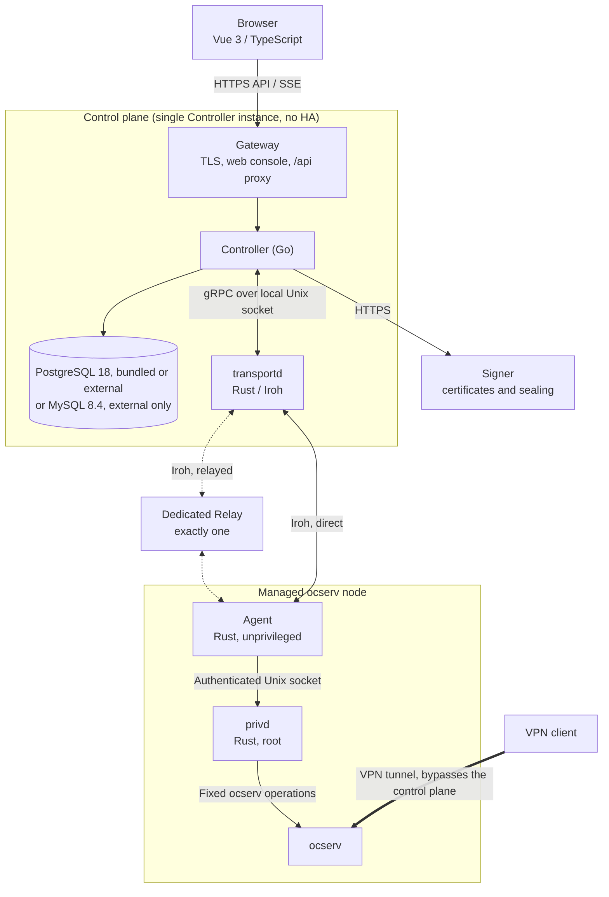

# ocservia

[](https://github.com/GentleKingson/ocservia/actions/workflows/ci.yml)
[](https://github.com/GentleKingson/ocservia/releases/latest)
[](#license)
[](control-plane/go.mod)
[](rust/Cargo.toml)
[](web/package.json)

ocservia manages [ocserv](https://ocserv.openconnect-vpn.net/) (OpenConnect VPN) server clusters from a central control plane while keeping VPN data traffic on the nodes themselves. Operators use it to monitor node health, provision user credentials and traffic quotas, inspect active sessions, and distribute signed configuration updates. Because client tunnels terminate directly at each ocserv instance, data plane packets bypass the central controller.

[Try it locally](#-try-it-locally-in-2-minutes) · [Operating model](#-what-makes-ocservia-different) · [Architecture](#-architecture-at-a-glance) · [Production deployment](#-deploying-to-production) · [Documentation](#-documentation)

## Features

- Continuous node monitoring covering connection states, daemon versions, active sessions, IP bans, and telemetry streams.
- Centralized user credential management with group policies, traffic quotas, and account expiration controls.
- Cryptographically signed administrative operations and audit records for session termination and IP ban revocation.
- Pre-deployment configuration validation that rolls back automatically on failure, or leaves the node for manual recovery if the rollback itself fails.
- Token-gated node enrollment using single-use tokens, signed endpoint proofs, and manual Controller approval.
- Managed node installation, upgrades, rollbacks, and removals pinned to verified releases.

<a id="-what-makes-ocservia-different"></a>
## Operating model

### VPN traffic stays on ocserv

Client VPN tunnels terminate directly on the ocserv nodes, keeping the Controller out of the packet path. If the Controller becomes unavailable, management workflows pause while established client VPN sessions stay connected.

### Privileged operations are bounded

On each managed host, the node agent runs as an unprivileged process and delegates root-level actions over an authenticated Unix domain socket to a local helper daemon (`privd`). Because `privd` exposes only a fixed set of ocserv maintenance tasks, neither the agent nor the Controller can invoke arbitrary binaries or shell commands.

### Sensitive changes require independent approval

High-risk operations must be requested and approved by independently authenticated principals using separate credentials and sessions; self-approval is rejected. Each approval is bound to the exact reviewed payload before the Controller signs the resulting command. Because this check operates at the principal and session layer, it cannot verify that two separate individuals control those credentials.

<a id="-architecture-at-a-glance"></a>
## Architecture

Operators and API clients reach the Go Controller through an HTTPS Gateway, which serves the web console and proxies the REST API and server-sent events (SSE) for state updates. For node communication, the Controller speaks gRPC over a local Unix domain socket to `transportd`, which manages the Iroh endpoint and maintains connections to remote agents.

Iroh connections run directly between endpoints when possible, or through the single dedicated Relay; multi-relay failover is not supported. The Relay forwards encrypted traffic only for clients that hold the relay access token and has no control-plane signing authority. The endpoints verify each other's EndpointID themselves, and commands carry Controller-signed session credentials and payload signatures. Node certificates and secret sealing are handled by a separate Signer service, so the Controller never holds the issuing CA key.



Signer and Relay run on separate hosts by default (Standalone mode) or on the Controller host in Integrated mode, where an SNI-routing Edge on public TCP 443 also fronts the Gateway and the Relay.

Within this pipeline, the Controller serves the HTTP APIs, schedules background jobs, tracks state transitions, and records audit logs in PostgreSQL 18.x (the default) or MySQL 8.4 LTS. On the nodes, agents report periodic health telemetry and hand off approved changes to `privd`. Supported database versions and backup boundaries are documented in the [support policy](docs/reference/support-policy.md), while process boundaries and threat assumptions are detailed in the [architecture and trust model](docs/architecture.md).

<a id="-try-it-locally-in-2-minutes"></a>
## Try it locally

A Docker Compose environment starts the Controller, web interface, database, and synthetic agent nodes without binding to a live ocserv daemon. Running it requires Git, Docker Compose, and open local ports on 4173 and 8080.

```bash
git clone https://github.com/GentleKingson/ocservia.git
cd ocservia

# Launch local stack with simulated nodes
deploy/compose/compose.sh up --build -d
```

Once the stack is up, the web console is available at [http://127.0.0.1:4173](http://127.0.0.1:4173), and Controller readiness and build metadata are exposed at `http://127.0.0.1:8080/readyz` and `http://127.0.0.1:8080/version`.

Run `deploy/compose/compose.sh down --volumes` to stop the containers and remove their storage volumes. Full local setup instructions are in [Try ocservia locally](docs/getting-started/local-development.md).

<a id="-deploying-to-production"></a>
## Deploying to production

### 1. Deploy the Controller

Store production configuration files in a working directory outside the repository checkout, and replace `vX.Y.Z` with an official release tag:

```bash
# Clone the pinned release
git clone --branch vX.Y.Z --single-branch --depth 1 \
  https://github.com/GentleKingson/ocservia.git ocservia-vX.Y.Z

mkdir ocservia-install && cd ocservia-install
cp ../ocservia-vX.Y.Z/install.env.example install.env
$EDITOR install.env

# Run the verified bootstrap
../ocservia-vX.Y.Z/deploy/production/controller-bootstrap.sh --version vX.Y.Z
```

The Controller authenticates operators through local credentials, OpenID Connect (OIDC), or both. Fresh installations do not create a default administrator account; when local login is enabled in a manual setup, the initial administrator is created with a separate one-shot bootstrap command as covered in [Production authentication](docs/operations/authentication.md).

By default, Standalone configurations run the Relay and Signer services on separate hosts, whereas Integrated mode runs them on the Controller host under the root lifecycle and requires additional configuration. Provision the required secrets according to [Deploy the Controller](docs/getting-started/production.md) before bootstrapping. When the selected stable or RC release includes Quick mode, the Quick preset can generate the configuration, material, and initial local administrators for a new Integrated host; releases up to v1.2.0 do not ship this preset (see [Deploy the Controller](docs/getting-started/production.md#quick-mode)).

### 2. Install a managed node

Run the node installer on each target ocserv host:

```bash
git clone --branch vX.Y.Z --single-branch --depth 1 \
  https://github.com/GentleKingson/ocservia.git ocservia-vX.Y.Z

mkdir ocservia-node-install && cd ocservia-node-install
cp ../ocservia-vX.Y.Z/install.env.example install.env
$EDITOR install.env

../ocservia-vX.Y.Z/deploy/managed-node/install.sh
```

Running the script without an enrollment token leaves the host in `ENROLLMENT_READY`. Supplying a token moves the state to `ENROLLED_LOCAL`, which registers the node locally without granting network access. Because the installer neither auto-approves nodes nor starts Agent/privd on initial installation (though the package lifecycle enables the retention timer and may restart existing services during an upgrade), onboarding completes only after you approve the node in the Controller interface, start the daemon processes, and confirm incoming telemetry. The full workflow is documented in [Install a managed node](docs/getting-started/managed-node.md) and [Enroll a node](docs/how-to/enroll-node.md).

<a id="-documentation"></a>
## Documentation

| Topic | Description |
| :--- | :--- |
| [Getting started](docs/README.md) | Walkthroughs for the local stack, production deployment, and first-node enrollment. |
| [Architecture and trust](docs/architecture.md) | System topology and process-level trust and privilege boundaries. |
| [Operations and runbooks](docs/operations/production-deployment.md) | Day-two deployment lifecycle, database configuration, and incident recovery. |
| [Troubleshooting](docs/how-to/troubleshooting.md) | Diagnostics covering service startup, OIDC, telemetry, and node enrollment. |
| [Support and versioning policy](docs/reference/support-policy.md) | Supported platforms and deployment scope, including cross-version limits. |
| [Technical reference](docs/README.md#technical-reference) | API schemas, wire protocols, and implementation contracts. |

## Development

Toolchain versions are pinned in the repository. To install the pinned dependencies and run the verification suite:

```bash
make bootstrap
make verify
```

Host prerequisites and the full set of module-level test targets and CI workflows are covered in [Contributor validation](docs/development/testing.md).

## Releases and compatibility

Starting with [`v1.1.0`](https://github.com/GentleKingson/ocservia/releases/tag/v1.1.0), compatibility across different versions is no longer tested, and a successful package install, upgrade, or rollback does not guarantee compatibility with an existing database state. Review the [support and versioning policy](docs/reference/support-policy.md) before applying version changes.

Production deployments should be pinned to official [published releases](https://github.com/GentleKingson/ocservia/releases); do not run development branches or release candidates in production. Although the [P1 resilience and capacity harness](docs/development/p1-resilience-capacity.md) exercises load and fault injection against synthetic agents, you should still validate target releases on your own infrastructure.

## Security

Administrative commands require cryptographic authorization, and high-risk changes enforce independent approval, replay protection, a command ledger, and signed receipts while restricting root execution on the node to a fixed set of operations. An accepted request (`202 Accepted`), a dispatched command, and an executed command are distinct states: acceptance atomically records the operation, its outbox entry, and audit intent without establishing remote execution, and a transport acknowledgement does not prove execution either. When a command outcome is uncertain, its state remains Unknown until exact durable evidence establishes the result, and operators must pause conflicting changes while reconciliation is in progress; see the [recovery boundary](docs/reference/stable-contracts.md#matched-release-recovery-boundary).

Report suspected vulnerabilities privately following [SECURITY.md](SECURITY.md).

## Community and support

- Open a [GitHub Issue](https://github.com/GentleKingson/ocservia/issues) for bug reports and technical questions, including reproduction steps, environment details, and relevant logs.
- Download release builds and archives from the [Releases page](https://github.com/GentleKingson/ocservia/releases).

<a id="license"></a>
## License and acknowledgements

ocservia is licensed under the [Apache License 2.0](LICENSE). Third-party software notices are maintained in [THIRD_PARTY_NOTICES.md](THIRD_PARTY_NOTICES.md).

ocservia is an independent project that interfaces with the [ocserv](https://ocserv.openconnect-vpn.net/) and OpenConnect ecosystem.
