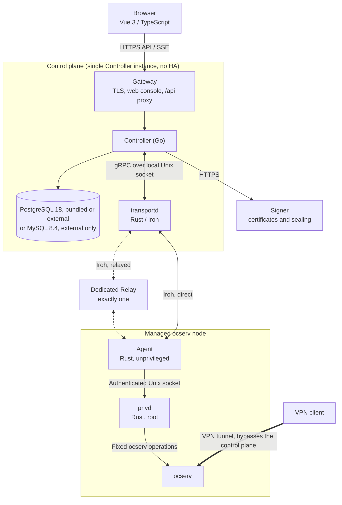

# ocservia

[](https://github.com/GentleKingson/ocservia/actions/workflows/ci.yml)
[](https://github.com/GentleKingson/ocservia/releases/latest)
[](#license)
[](control-plane/go.mod)
[](rust/Cargo.toml)
[](web/package.json)

ocservia is a central control plane for clusters of [ocserv](https://ocserv.openconnect-vpn.net/) (OpenConnect VPN) servers. From one web console or HTTP API, you can monitor node health, provision user credentials and traffic quotas, inspect active sessions, and distribute signed configuration updates, without opening a shell on each server.

ocservia does not replace ocserv. Every managed server keeps running ocserv, which terminates client tunnels and forwards their traffic. ocservia installs its node daemons alongside it and connects them to a central Controller.

[Try it locally](#-try-it-locally-in-2-minutes) · [Operating model](#-what-makes-ocservia-different) · [Architecture](#-architecture-at-a-glance) · [Production deployment](#-deploying-to-production) · [Documentation](#-documentation)

## Features

- Monitor node connection states, daemon versions, active sessions, IP bans, and telemetry streams.
- Manage user credentials centrally, with group policies, traffic quotas, and account expiration.
- Terminate sessions and revoke IP bans through cryptographically signed administrative operations, each with an audit record.
- Validate configuration before it is deployed. A failed deployment rolls back automatically; if the rollback itself fails, the node is left for manual recovery.
- Enroll nodes with single-use tokens and signed endpoint proofs, followed by manual approval in the Controller.
- Install, upgrade, roll back, and remove managed nodes using verified, pinned releases.

<a id="-what-makes-ocservia-different"></a>
## Operating model

### VPN traffic stays on ocserv

Client VPN tunnels terminate directly on the ocserv nodes, so the Controller is never in the packet path. If the Controller becomes unavailable, management workflows pause, and client VPN sessions that are already established stay connected.

### Privileged operations are bounded

On each managed host, the node agent runs as an unprivileged process. When it needs a root-level action, it asks a local helper daemon, `privd`, over an authenticated Unix domain socket. `privd` exposes only a fixed set of ocserv maintenance tasks, so neither the agent nor the Controller can invoke arbitrary binaries or shell commands.

### Sensitive changes require independent approval

A high-risk operation needs two principals: one to request it and another to approve it, each authenticated independently with separate credentials and sessions. Self-approval is rejected. Each approval is bound to the exact payload the approver reviewed, and the Controller signs the resulting command only after that. Because the check works at the level of principals and sessions, it cannot verify that two different people control those credentials.

<a id="-architecture-at-a-glance"></a>
## Architecture

Operators and API clients reach the Go Controller through an HTTPS Gateway. The Gateway serves the web console and proxies the REST API, including the server-sent events (SSE) stream for state updates. To reach the nodes, the Controller speaks gRPC over a local Unix domain socket to `transportd`, which manages the Iroh endpoint and maintains connections to the remote agents.

Iroh connects the endpoints directly when it can, and otherwise goes through the single dedicated Relay. Multi-relay failover is not supported. The Relay forwards encrypted traffic only for clients that hold the relay access token, and it has no control-plane signing authority. The endpoints verify each other's EndpointID themselves, and commands carry Controller-signed session credentials and payload signatures. A separate Signer service handles node certificates and secret sealing, so the Controller never holds the issuing CA key.



By default (Standalone mode), the Signer and the Relay run on hosts separate from the Controller. In Integrated mode they run on the Controller host, and an SNI-routing Edge on public TCP 443 fronts both the Gateway and the Relay.

The Controller serves the HTTP APIs, schedules background jobs, tracks state transitions, and records audit logs in PostgreSQL 18.x (the default) or MySQL 8.4 LTS. On the nodes, agents report periodic health telemetry and hand approved changes to `privd`. The [support scope](docs/operations/production-deployment.md#support-scope) lists supported database versions and backup boundaries, and the [architecture and trust model](docs/architecture.md) describes process boundaries and threat assumptions.

<a id="-try-it-locally-in-2-minutes"></a>
## Try it locally

To explore ocservia without a real VPN server, run the local Docker Compose stack. It starts the Controller, the web interface, a database, and synthetic agent nodes that do not bind to a live ocserv daemon. You need Git, Docker Compose, and free local ports 4173 and 8080.

```bash
git clone https://github.com/GentleKingson/ocservia.git
cd ocservia

# Launch local stack with simulated nodes
deploy/compose/compose.sh up --build -d
```

When the stack is up, open the web console at [http://127.0.0.1:4173](http://127.0.0.1:4173). The Controller reports readiness at `http://127.0.0.1:8080/readyz` and build metadata at `http://127.0.0.1:8080/version`.

The first run builds the container images locally and needs network access. The stack uses PostgreSQL by default. To use the pinned MySQL 8.4 LTS development database instead, set `OCSERV_DATABASE_BACKEND=mysql` before you run the launcher. The script picks the matching Compose descriptor and rejects unknown backend values. Pass the same `OCSERV_DATABASE_BACKEND` value to every later `compose.sh` command for that stack, including `down`. To use other host ports, set `OCSERV_WEB_PORT` and `OCSERV_HTTP_PORT`.

The stack is for local evaluation and testing only. It uses fixed development credentials, a development-only authentication token, and the bounded agent simulator (`OCSERV_LOCAL_SIMULATOR=true`), and it does not manage a real ocserv daemon. Keep it bound to the loopback ports above, and do not reuse it for a production Controller, relay, or managed node. The simulator is reachable only through the development `/dev` page, a route that the production runtime never registers. From `/dev`, you can trigger normal, duplicate-event, error, and disconnect probe scenarios.

To tear down the stack and delete its database volume, run the command below. This permanently removes all simulator and database state.

```bash
deploy/compose/compose.sh down --volumes
```

<a id="-deploying-to-production"></a>
## Deploying to production

### 1. Deploy the Controller

Keep production configuration files in a working directory outside the repository checkout. In the commands below, replace `vX.Y.Z` with an official release tag:

```bash
# Clone the pinned release
git clone --branch vX.Y.Z --single-branch --depth 1 \
  https://github.com/GentleKingson/ocservia.git ocservia-vX.Y.Z

mkdir ocservia-install && cd ocservia-install
cp ../ocservia-vX.Y.Z/install.env.example install.env
$EDITOR install.env

# Run the verified bootstrap
../ocservia-vX.Y.Z/deploy/production/controller-bootstrap.sh --version vX.Y.Z
```

Operators sign in with local credentials, OpenID Connect (OIDC), or both. A fresh installation has no default administrator account. If you enable local login in a manual setup, create the first administrator with the separate one-shot bootstrap command described in [Production authentication](docs/operations/authentication.md#bootstrap-the-first-local-admin).

The default Standalone mode runs the Relay and the Signer on separate hosts. Integrated mode runs them on the Controller host under the root lifecycle and needs additional configuration. Before you run the bootstrap, provision the required secrets as described in [Production deployment](docs/operations/production-deployment.md#prepare-the-configuration).

For a new Integrated host, the Quick preset can generate the configuration, cryptographic material, and initial local administrators, as long as the stable or RC release you selected includes Quick mode. Releases up to v1.2.0 do not ship this preset (see [Quick mode](docs/operations/production-deployment.md#quick-mode)).

### 2. Install a managed node

On each ocserv host you want to manage, run the node installer from the same release:

```bash
git clone --branch vX.Y.Z --single-branch --depth 1 \
  https://github.com/GentleKingson/ocservia.git ocservia-vX.Y.Z

mkdir ocservia-node-install && cd ocservia-node-install
cp ../ocservia-vX.Y.Z/install.env.example install.env
$EDITOR install.env

../ocservia-vX.Y.Z/deploy/managed-node/install.sh
```

Without an enrollment token, the installer leaves the host in `ENROLLMENT_READY`. With a token, it completes enrollment and reports `ENROLLED_LOCAL`: the Controller now holds a pending record for the node, but the node has no control-plane access until it is approved.

The installer never approves nodes, and it does not start the Agent or `privd` on an initial installation. (The package lifecycle does enable the retention timer, and an upgrade may restart services that are already running.) To finish onboarding, have a second authorized principal approve the node in the Controller interface, start the daemon processes, and confirm that telemetry is arriving. [Agent lifecycle](docs/operations/agent-lifecycle.md) covers the full workflow, from installation and enrollment to approval and the first start.

<a id="-documentation"></a>
## Documentation

| Document | What it covers |
| :--- | :--- |
| [Architecture](docs/architecture.md) | Components, call chains, responsibility owners, and permission and state boundaries. |
| [Stable contracts](docs/reference/stable-contracts.md) | Rules that changes must keep: command delivery and receipts, identity and approval, database artifacts, and protocol generation. |
| [Production deployment](docs/operations/production-deployment.md) | Support scope, Controller and Relay installation in Quick or manual, Standalone or Integrated form, and upgrade, rollback and uninstall. |
| [Agent lifecycle](docs/operations/agent-lifecycle.md) | Node installation, enrollment, independent approval, upgrade, rollback, rebind, and removal. |
| [Authentication](docs/operations/authentication.md) | Local, OIDC, and mixed sign-in, the first administrators, and identity and session operations. |
| [Incident recovery](docs/operations/incident-recovery.md) | Database and Signer backup and restore, Unknown command reconciliation, and credential recovery. |
| [Validation and release](docs/development/release-checks.md) | Checks for each kind of change, CI layers, three-VM acceptance, and the release process. |

The frozen wire formats for signed commands are specified in [command authorization v1](docs/development/command-authorization-v1.md), [command semantic hash v1](docs/development/command-semantic-hash-v1.md), and [command semantic hash v2](docs/development/command-semantic-hash-v2.md). HTTP endpoints and fields are defined in [`openapi/openapi.yaml`](openapi/openapi.yaml), and Protobuf messages in [`proto/`](proto/).

## Development

The repository pins its toolchain versions. To install the pinned toolchains and run the local verification suite:

```bash
make bootstrap
make verify
```

`make verify` is a broad local baseline; for most edits, pick a narrower check from [Validation and release](docs/development/release-checks.md#choose-the-validation-scope), which also covers host prerequisites and CI workflows. Running `make generate` overwrites all generated code, so do not edit `control-plane/gen/proto`, `rust/crates/contracts/src/generated`, or `web/src/api/generated` by hand.

## Releases and compatibility

Starting with [`v1.1.0`](https://github.com/GentleKingson/ocservia/releases/tag/v1.1.0), compatibility between different versions is no longer tested. A package install, upgrade, or rollback that succeeds does not guarantee compatibility with an existing database state. Read the [version policy](docs/operations/production-deployment.md#version-policy) before you change versions.

Pin production deployments to official [published releases](https://github.com/GentleKingson/ocservia/releases), and do not run development branches or release candidates in production. The [resilience and capacity harness](docs/development/release-checks.md#resilience-and-capacity) exercises load and fault injection against synthetic agents; you should still validate each target release on your own infrastructure.

## Security

Administrative commands require cryptographic authorization. High-risk changes also require independent approval and are covered by replay protection, a command ledger, and signed receipts. On the node, root execution is restricted to a fixed set of operations.

Accepting, dispatching, and executing a command are distinct states. When the Controller answers `202 Accepted`, it has atomically recorded the operation, its outbox entry, and the audit intent; that alone does not establish remote execution. A transport acknowledgement does not prove execution either. If a command's outcome is uncertain, its state remains Unknown until exact durable evidence establishes the result, and operators must pause conflicting changes while reconciliation is in progress. See the [recovery boundary](docs/reference/stable-contracts.md#matched-release-recovery-boundary) for details.

To report a suspected vulnerability, follow the private process in [SECURITY.md](SECURITY.md).

## Community and support

- Open a [GitHub Issue](https://github.com/GentleKingson/ocservia/issues) for bug reports and technical questions. Include reproduction steps, environment details, and relevant logs.
- Download release builds and archives from the [Releases page](https://github.com/GentleKingson/ocservia/releases).

<a id="license"></a>
## License and acknowledgements

ocservia is licensed under the [Apache License 2.0](LICENSE). Third-party software notices are in [THIRD_PARTY_NOTICES.md](THIRD_PARTY_NOTICES.md).

ocservia is an independent project that interfaces with the [ocserv](https://ocserv.openconnect-vpn.net/) and OpenConnect ecosystem.
