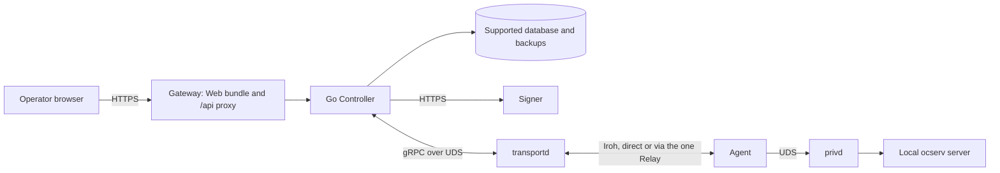
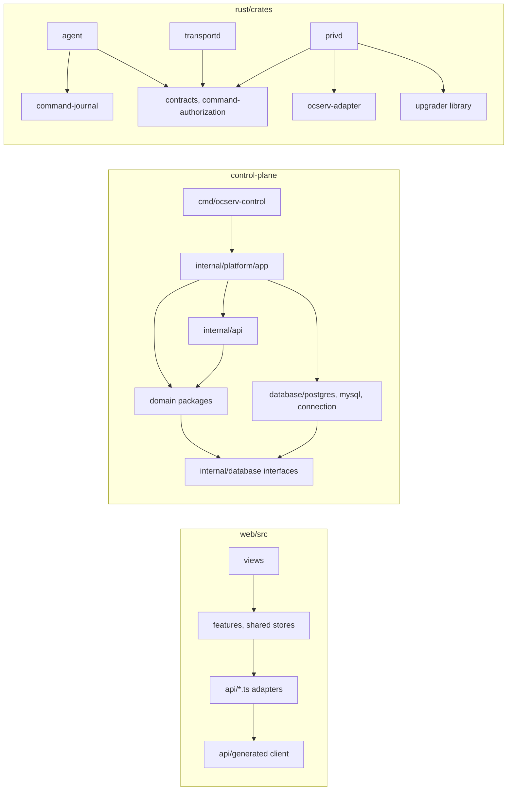

# Architecture

ocservia provides a central control plane for OpenConnect (ocserv) VPN gateways while leaving client tunnel termination and packet forwarding on the gateways themselves. Node administration runs through the Controller, which coordinates cluster visibility, user and group provisioning, configuration distribution, node enrollment, software updates, audit logging, and state recovery.

## Purpose and constraints

Operators use the control plane to verify node trust and reachability, roll out configuration changes without interactive shell access, and reconcile commands whose outcomes become ambiguous. High-risk changes require approval from a second, independently authenticated principal, and disaster recovery preserves node identities alongside the recorded history of state transitions.

A supported production deployment consists of one Controller instance, a relational database, a Signer service for certificate issuance, and a single dedicated Relay serving multiple Agents (a non-empty second Relay URL is rejected). Those services can run on separate hosts, or co-locate on the Controller host in Integrated mode. High-availability topologies such as multi-master Controller clusters, redundant Relays, and automated database failover are outside the [supported scope](operations/production-deployment.md#deployment-capability-distinctions); internal lease mechanisms and package modularity do not imply HA support. Production hosts must match the [production support matrix](operations/production-deployment.md#database-support), and development and test fixtures do not expand it.

Control and data planes remain separate at runtime. Client VPN sessions terminate on the ocserv nodes, and tunnel payloads never pass through the Controller, transportd, or the Relay. If the control plane goes offline, administrative writes, validation, and new command dispatch stop. Established client VPN tunnels stay up unless the local node crashes or an invalid ocserv reload disrupts the daemon. Production deployments require pre-provisioned cryptographic keys, working DNS and TLS, a supported database, the Signer service, and an OpenID Connect (OIDC) provider when single sign-on is enabled.

## High-level view



## Main pieces

| Piece | Runs on | What it does |
| --- | --- | --- |
| Gateway | Controller server | Terminates Controller TLS, serves the static Web bundle, and proxies `/api` to the Controller. Integrated mode places an SNI-routing Edge in front of it. |
| Go Controller | Controller server | Serves the HTTP API and runs the outbox worker, scheduler, audit subsystem, node directory, and command dispatch pipeline according to `--role`. |
| transportd | Controller side | Terminates Iroh overlay connections and exposes a local gRPC Unix domain socket to the Go Controller. It holds no database credentials and checks session authorization through a trust socket served by the Controller. |
| Supported database | Controller side | Stores control-plane state, task queues, and recovery journals. PostgreSQL is the default backend. |
| Dedicated Relay | Operator-managed relay host (one) | Forwards encrypted control-plane traffic between the Controller and Agents across NAT or firewall boundaries. Production supports exactly one Relay. |
| Signer | Separate service (bundled in Integrated mode) | Issues and revokes node client certificates and seals secrets to node public keys. See [Certificates, secrets and Signer](#certificates-secrets-and-signer). |
| Managed node service | Each ocserv server | Maintains the Controller connection, reports telemetry and heartbeats, accepts verified commands, and records local execution state. |
| Local privileged helper | Each ocserv server | Executes a fixed set of root-privileged ocserv maintenance routines on behalf of the node agent. |
| Upgrader | Each managed node | Runs package installations, upgrades, and rollbacks outside the main Agent execution loop. |
| ocserv | Each VPN server | The OpenConnect VPN daemon that terminates client tunnels and forwards VPN traffic. |
| External services | Operator environment | Optional or environment-supplied infrastructure for OIDC authentication, telemetry collection, secret storage, and backups. |

Ownership, secrets, interfaces, and failure impact by process:

| Process | Storage and secrets | Interfaces | If it stops |
| --- | --- | --- | --- |
| Gateway | Controller TLS key; no business state | TCP 443 to browsers; HTTP to the Controller | Web UI and HTTP API become unreachable; Controller state and running nodes are unaffected. |
| Go Controller (`--role=all`, single instance in production) | Owns trust, operations, outbox, and audit state in the database; holds the command-signing key, session and audit keys, database application credential, and Signer token | HTTP behind Gateway; client of the transportd socket; serves the trust socket; HTTPS to Signer | Request validation, durable writes, and command dispatch pause; queued operations remain in the outbox. |
| Database | Sole durable store for Controller state | Controller only | Same impact as a Controller outage; restore using [database recovery](operations/incident-recovery.md#database-recovery). |
| transportd | Iroh endpoint key, Relay token, and Controller command verification key; no database credentials | gRPC `TransportService` on a Unix socket; calls the trust socket; Iroh to Agents | Command dispatch and result ingestion pause; in-flight outcomes may become `unknown` until reconciled. |
| Signer | Issuing intermediate key, HTTPS key, and durable certificate ledger | HTTPS `:9443`, on an internal network reachable by the Controller in Integrated mode | Certificate issuance, revocation, and secret sealing fail while unrelated workflows continue. |
| Relay | Relay TLS key and shared access token; no control-plane authority | HTTPS and UDP 7842 | Relay-routed control connections drop, though direct peer paths may stay up. Client VPN traffic is unaffected. |
| Agent | Local SQLite journal and Controller verification key | Outbound Iroh; Unix socket to privd | That node stops receiving commands and sending telemetry; its local journal persists across restarts. |
| privd | Root effect store, attestation key, Controller keyring, and the two sealing private keys | `/run/ocserv-platform/privd.sock`, no TCP listener | Privileged node operations fail or remain indeterminate. |
| upgrader | One-shot `ocservia-upgrader@<operation>.service` started by privd | systemd | Node package upgrades do not advance; see [Agent lifecycle](operations/agent-lifecycle.md). |

At runtime, the Go Controller talks to `transportd` over a local Unix domain socket. `transportd` exchanges versioned Protocol Buffer messages with remote `Agent` processes over an Iroh overlay, either directly or through the dedicated Relay. On each managed host, the unprivileged `Agent` calls `privd` over a local Unix domain socket for root-level operations. Both the `transportd` control/trust sockets and the `privd` socket enforce peer UID and filesystem ownership checks. The Relay forwards encrypted packets without holding control-plane signing authority. Local development can substitute `transportd-stub` and `OCSERV_LOCAL_SIMULATOR` (both rejected in production) for the Iroh path. [Transport](#transport) and [Agent, privd and upgrader](#agent-privd-and-upgrader) cover process responsibilities, and [Stable contracts](reference/stable-contracts.md#commands-and-recovery) holds the wire and recovery rules.

## How a node change is applied

```text
Operator request
  -> Controller validates and records the request
  -> high-risk changes wait for independent approval
  -> Controller sends a signed, fixed operation to the node
  -> node runs the matching local ocserv action
  -> result and audit record return to the Controller
```

Command processing separates request acceptance from remote execution across four stages:

1. Ingestion and transactional staging: The HTTP handler routes the request to the owning domain service. Within a single database transaction, the service checks node state and operator permissions, then writes the operation record, payload, transactional outbox entry, and audit event. Committing that transaction records acceptance only; the node has not yet run the command.
2. Outbox dispatch: A background worker claims pending outbox rows in batches and hands them to `transportd` over the active session for that node. Recording dispatch confirms that the message was handed to the transport layer, not that execution succeeded on the host.
3. Node admission and idempotency: Before executing a command, the `Agent` verifies the signature and records the command ID and semantic hash in its local SQLite journal. Duplicate deliveries with the same ID and semantic hash replay the stored result without re-running the action. A different payload under an existing command ID is rejected immediately.
4. Privileged execution and settlement: For mutating operations, the `Agent` marks the journal entry `running` and invokes `privd` over the local Unix socket. `privd` checks the request against its fixed operation rules, executes the ocserv action, and returns a signed execution receipt. The `Agent` persists the terminal status to disk before acknowledging delivery. The Controller worker then ingests the returned event via `transportevents.Service.Ingest` (which also processes telemetry), so HTTP queries and Server-Sent Event (SSE) subscribers see the settled state.

The implementation spans the [operation service](../control-plane/internal/operations/service.go), the [outbox worker](../control-plane/internal/operations/worker.go), and the [Agent execution path](../rust/crates/agent/src/main.rs), with idempotency and reconciliation rules defined in the [delivery and recovery contract](reference/stable-contracts.md#commands-and-recovery). Controller database commits, network transport, and host-level daemon effects do not share a distributed transaction, so crashes or transport drops can leave an operation in an `unknown` state. Recovery workflows must reconcile `unknown` commands against durable node receipts before any retry. A healthy daemon status alone cannot prove whether an interrupted reload took effect.

### Code path of a controlled node operation

The table below traces `service:reload`. Other controlled operations share the operation outbox and Agent external-command pipeline. Each defines its own HTTP handlers, RBAC checks, and domain transactions at its entry point.

| Hop | Entry point | Owner and boundary |
| --- | --- | --- |
| Browser | [`NodeDetailView.vue`](../web/src/views/NodeDetailView.vue) → [`shared/fleet.ts`](../web/src/shared/fleet.ts) `reloadService` → [`api/operations.ts`](../web/src/api/operations.ts) `reloadService` → generated client → [`api/transport.ts`](../web/src/api/transport.ts) | Fleet store tracks operation state; the adapter attaches `Idempotency-Key`, `If-Match`, and approval headers. UI visibility is not authorization. |
| HTTP | [`api/routes.go`](../control-plane/internal/api/routes.go) `POST /api/v1/nodes/{node_id}/service:reload` → [`requireOperationAuth`](../control-plane/internal/api/authorization.go) → [`createControlledCommand`](../control-plane/internal/api/operations.go) | Authenticates the caller, runs `validateBrowserMutation` (mutating requests from non-development principals must carry the trusted browser `Origin`), enforces route RBAC and payload validation, and returns HTTP `202` with the staged operation record. |
| Acceptance | [`operations.Service.Create`](../control-plane/internal/operations/service.go) | A single database transaction verifies the expected node revision, consumes the bound approval, and writes the operation, outbox entry, and audit record. |
| Dispatch | [`operations.Worker.dispatch`](../control-plane/internal/operations/worker.go) → [`Service.Claim`](../control-plane/internal/operations/dispatch.go) → `dispatchFenced` → [`transportclient`](../control-plane/internal/transportclient/) | Claims up to 16 jobs and dispatches them serially. Commands carry an owner fence whenever [`startWorker`](../control-plane/internal/platform/app/worker.go) has initialized an owner-session manager (enabled when `OCSERV_CONTROLLER_ENDPOINT_ID` is set, as required in production Compose; only the local simulator path sends unfenced). `MarkSentWithEnvelope` records transmission only. |
| Transport | [`transportd`](../rust/crates/transportd/src/lib.rs) `send_command` | Unprivileged process that forwards the envelope over the authorized Iroh session. |
| Node | [`agent` `execute_external_command`](../rust/crates/agent/src/main.rs) → [`CommandExecutor::prepare_external`](../rust/crates/agent/src/lib.rs) → [`command-journal`](../rust/crates/command-journal/src/lib.rs) `accept_command` → `PrivdClient` → [`privd`](../rust/crates/privd/src/lib.rs) `dispatch_attested` | The journal transitions through `Accepted` and `Running` before `privd` runs the compiled action and signs a receipt. A command reaches a terminal state only with a valid `privd` receipt; missing receipts, unclassified `privd` errors, transport drops, or replays of non-terminal entries settle as `Unknown` without re-executing. |
| Result | [`transportevents.Worker`](../control-plane/internal/transportevents/) → [`Service.Ingest`](../control-plane/internal/transportevents/ingress.go) | Verifies each incoming transport event and commits its result or telemetry in a single transaction. Upon owner reconnect, [`RecoverAmbiguousDispatched`](../control-plane/internal/operations/recovery.go) re-signs ambiguous commands as `RECONCILE_ONLY`; see [Controller delivery](reference/stable-contracts.md#controller-delivery). |

Privileged execution on a managed node is limited to compiled routines inside `privd`, which rejects arbitrary binaries, shell command strings, dynamic systemd unit names, and unconstrained filesystem paths.

Node enrollment uses a separate handshake protocol. A single-use token binds the node's persistent `EndpointID` to a pending inventory record. The node then requires independent two-principal approval before the `Agent` can establish an authenticated control session. Installing the package or starting local services does not grant control-plane access prior to approval; see [enrollment](operations/agent-lifecycle.md#enroll-the-node) and [`enrollment/service.go`](../control-plane/internal/enrollment/service.go).

## State and recovery boundaries

| State | Authority and persistence | Recovery consequence |
| --- | --- | --- |
| Node trust, desired state, operations and audit history | Controller database, accessed through domain Store contracts | When a commit outcome is uncertain, preserve the original operation ID and payload; client timeouts must not trigger uncoordinated duplicate submissions. |
| Command acceptance and results | Agent-owned SQLite journal | The local journal must persist across service restarts and package upgrades. Deleting it breaks replay detection and outcome reconciliation. |
| Privileged effects | Node-side effect records and signed privd receipts | Reconciliation requires cryptographic receipts bound to the specific command ID; observing the target configuration hash on disk does not prove a specific historical command succeeded. |
| Certificate issuance and revocation | Signer's durable ledger and issuing identity | Restoring the Controller database and Signer ledger must be coordinated before certificate operations resume. Recorded revocations do not terminate active VPN tunnels or publish external CRLs automatically. |
| Health and session observations | Agent reports ingested into Controller read models | Cached telemetry reflects the last ingested report and does not prove that the node or ocserv daemon is currently reachable. |

An outage of the Controller or its database halts request validation and durable writes, leaving queued operations in the outbox until they either run after recovery or expire. If `Agent` or `privd` crashes during execution, the operation remains indeterminate even when network delivery succeeded. If the Relay becomes unreachable, control-plane sessions through that Relay drop until the Relay returns and the Controller reconciles pending node state.

Recovery procedures preserve command logs, local SQLite journals, endpoint identities, and monotonic sequence numbers. Restoring from a cold backup requires running the documented verification workflow. A restore provides no automatic failover and does not relax schema identity checks. For details, see [incident recovery](operations/incident-recovery.md), [Signer backup and restore](operations/incident-recovery.md#signer-backup-and-restore), and [resilience coverage](development/release-checks.md#resilience-and-capacity).

## Design tradeoffs and capacity

The Controller is structured as a modular monolith in which domain services share relational database transactions. Keeping domain state changes, outbox staging, and audit records in a single local transaction avoids two-phase commit or external message brokers while the deployment model remains single-instance. [Controller assembly and roles](#controller-assembly-and-roles) describes how one binary starts the API, worker, and scheduler roles, with production running a single `all` instance.

Using a database-backed transactional outbox means task leasing, historical audit queries, and live API writes share the same database connection pool and row locks. Polling loops backstop in-memory wakeups so queued commands still drain after transient notification drops. Local `Agent` journals prevent duplicate side effects on redelivery, and ambiguous executions pause for explicit reconciliation.

Separating `transportd`, `Agent`, `privd`, and `upgrader` into distinct OS processes adds local IPC hops and systemd coordination, in exchange for keeping network-facing parsing and unprivileged state management separate from root execution and package lifecycle scripts.

End-to-end command throughput is bounded by database lock contention, outbox worker polling intervals, and serial execution of mutating commands on each node. Both the Controller [outbox worker](../control-plane/internal/operations/worker.go) and the node `Agent` process claimed mutating commands sequentially. The global [command limit](../control-plane/internal/commandlimit/limit.go) acts as backpressure admission control across nodes and workspaces.

Before tuning concurrency settings or splitting services, measure queue depth, maximum uncommitted task age, database lock wait times, and telemetry age under representative load. Low [queue metrics](reference/stable-contracts.md#controller-delivery) indicate fast dispatch from the Controller outbox, though downstream node execution must still be verified independently. Any proposal to split a subsystem into a standalone service should be driven by measured scaling, release-isolation, or fault-isolation needs and validated against fault-recovery scenarios.

## Safety model

- Production deployments pin immutable release tags or container image digests.
- Managed-node packages are verified against an expected SHA-256 digest (supplied by the operator or a signed Controller upgrade command) before installation; a plain checksum guards against file corruption and does not grant execution authority.
- Private keys, TLS certificates, relay access tokens, and database or admin credentials are provisioned out of band in protected host directories.
- High-risk mutations require independent two-principal approval bound to the exact request payload, with self-approval rejected. The system enforces separation across two distinct authenticated principals, credentials, and sessions. Human two-person custody of those credentials remains outside what the software can automatically verify ([approval principal boundary](reference/stable-contracts.md#approval-principal-boundary)).
- Audit events commit in the same database transaction as the state changes they record.
- Production rollouts require tested backup restoration and rollback procedures.

## Component responsibilities

Each subsection names who owns a behavior and where the boundary sits. Exact rules and limits live in [Stable contracts](reference/stable-contracts.md).

### Controller assembly and roles

`cmd/ocserv-control` starts [`platform/app`](../control-plane/internal/platform/app/), which opens the database, runs the startup checks for the requested mode, and wires the domain services. Domain packages do not import assembly packages. The binary runs as `--role=api`, `--role=worker`, `--role=scheduler`, or `--role=all`, and production runs a single `all` instance.

- The api role serves the HTTP API and the event streams. Other roles exit before authentication or HTTP construction.
- The worker role runs the operation outbox worker, ingests transport events, runs trust convergence, and serves the trust socket that transportd calls.
- The scheduler role runs one maintenance session at a time under a database leadership lease, ticking every 30 seconds. The fixed steps are user operations, Agent rollouts, telemetry rollups, certificate maintenance, audit checkpoints, and history retention. Only a rollout error lets the rest of the pass continue.
- On `SIGINT`/`SIGTERM` or the first role error, the process stops HTTP admission and event streams, closes the trust socket, and waits up to `OCSERV_SHUTDOWN_TIMEOUT` for in-flight tasks.

The scheduler classifies a failed maintenance session in [`scheduler.go`](../control-plane/internal/platform/app/scheduler.go). Leadership loss, a policy enforcement cleanup failure, and a temporarily unavailable database are logged and wait for the next tick. A cleanup failure also skips the remaining steps of that pass. During a database outage the HTTP server stays running so readiness can report it, and the scheduler neither replays transaction callbacks nor claims a known commit outcome. Any other error is logged as `alert_kind=user_operations.scheduler_failed` and ends the role, so the process exits and the service supervisor restarts it. Cancellation of the process context ends the loop in every case.

Database ownership is split between two entry points. A separate one-shot `--migrate-only` run uses the owner connection to apply schema changes, verify checksums and receipts, check audit event authentication, and only then grant access to the unprivileged runtime role. The long-running process holds only runtime credentials. Normal startup validates the deployment and audit authenticity, and `/readyz` reads the core tables. Neither is evidence of full checksum or receipt verification. The rules are in [Database](reference/stable-contracts.md#database).

The development stack in `deploy/compose` pairs the Controller with a Rust transport stub and a bounded node simulator, and avoids Iroh, ocserv, and privileged execution. The simulator is off unless `OCSERV_LOCAL_SIMULATOR=true` and is rejected in production builds. Development bearer authentication carries no persisted identity, so it cannot create or approve approvals. Production rejects both. The [README](../README.md#try-it-locally) has the commands.

### Domain services and transactions

Names follow the responsibility being described: domain services own behavior; stores expose transaction-bound persistence; backend adapters implement database dialects. Production transport events and development simulation are separate concepts even where they share a service. Node IDs name managed nodes, while Endpoint IDs name transport identities. An Operation describes business intent; a Command is the signed execution request. A privd receipt proves an execution effect, while a Web workflow reference only locates server state.

Each domain service owns its business invariants and opens its own transaction. Consumers depend on narrow method sets defined where they are used. These interfaces mark Go package boundaries and are not runtime authorization boundaries.

| Consumer | Capability it consumes | Transaction owner |
| --- | --- | --- |
| `configplan.Service` | `operationCreator.Create` for Create and Apply | ConfigPlan owns its pre-read transactions. Operations commits command, Plan, outbox, and audit rows and consumes the approval. |
| `useroperations.Service` | `userMutator.Mutate` for monthly reset, enforcement, and batch submission | UserOperations owns policy, claim, and receipt state. UserState commits desired state, command, outbox, and audit rows and checks fencing. |
| `configplanhttp.Handler` | `Plans.Create/Get/Apply` | The existing domain services. |
| Parent authorization and approval HTTP | `configPlanLookup.ApprovalBinding/Resource` | Approval creation and decision stay in the parent. Consumption stays in Operations. |

- `platform/app` passes the configured service instances together with the caller's original request or scheduler context, which keeps any leadership fence active. Read-only and validation paths can run without a writer. A nil writer never falls back to another path and never lets a write succeed.
- All stores that take part in one business operation bind to the same `database.Tx` inside `database.Within`. Business locks are PostgreSQL advisory locks and MySQL `business_locks` rows. A commit acknowledgement error leaves the outcome unknown, so callers do not replay writes blindly. Only database-only claim, completion, reaping, and lease work uses the retrying helper.
- Upgrade preparation belongs to Operations. `PrepareAgentUpgrade` and `AgentUpgradeApprovalBinding` resolve the target through `RBACStore.UpgradeNode` and the operator-provisioned release catalog. `Create` still takes the locks, checks versions and replay state, validates node capabilities and attestation, consumes the approval, and enforces the active-upgrade guard. Approving an upgrade binds a trusted catalog entry. It does not promise that the target is newer than the node's build.
- `configplan.Service.ApprovalBinding` loads the plan through the interpreted `Get` path and checks status and expiry against the service clock. The HTTP layer checks the selected workspace and the node `config.apply` permission. Apply prechecks, desired-revision allocation, and approval consumption stay with their domain owners.
- Lease and fence checks read a fresh database time after taking their locks. Takeovers increment the retained epoch in place, so stale holders keep failing their owner and epoch predicates.

### HTTP layer

[`internal/api`](../control-plane/internal/api/) owns HTTP server assembly, middleware, and resource authorization. The `nodehttp`, `configplanhttp`, and `useroperationshttp` packages implement their handlers against narrow consumer interfaces. Splitting handlers across packages does not replace runtime authorization or divide domain transactions.

- Assembly: `api.NewServer` builds the server from validated inputs. `newHTTPServer` in `platform/app` constructs those inputs, calls `NewServer`, and then runs the `Enable*` setters for capabilities that live outside `Modules` before the listener opens. A concrete typed nil is treated as a disabled capability, never replaced by a fallback service. Submodules keep only their narrow interfaces and never hold assembly inputs, raw stores, transport handles, or a reference to the parent server.
- Middleware order is fixed: `otelhttp -> requestContext -> limitBody -> timeout -> trackRequests -> routeErrors -> ServeMux -> route wrapper -> handler`. Event streams bypass the request timeout and stay tracked for shutdown.
- Routing: method metadata comes from the ordinary `HandleFunc` registrations, and a conflicting or unsupported pattern panics at startup. [`routes_baseline_test.go`](../control-plane/internal/api/routes_baseline_test.go) checks the live route inventory, wrappers, allowed methods, and required permissions.
- Authorization: every modular route sits behind a guard that authenticates the caller, applies browser mutation protection, resolves the resource and its workspace, authorizes the action, and injects trusted request context. A client-supplied workspace header never establishes authority on its own. `httpx` holds JSON and Problem encoding, cursors, and idempotency key helpers without importing authentication or domain packages.
- Event streams: platform and operation streams share one admission manager. A single reference-counted watcher per workspace or operation polls the durable event tables and fans events out through bounded queues. The stream is an invalidation signal, and the REST collections are the authoritative source for state. Limits come from validated `OCSERV_SSE_*` settings.
- Shutdown: the server closes stream admission and hubs, starts HTTP shutdown, closes remaining connections at the deadline, and waits for in-flight handlers. It never closes the shared database pool or domain services.

Status codes, error precedence, header rules, and per-route behavior are in [HTTP contracts](reference/stable-contracts.md#http-contracts).

### Web client

The Vue console lives in `web/src`. [`main.ts`](../web/src/main.ts) registers Pinia, the router, and i18n and mounts after `router.isReady()`, so `/login` never flashes the shell. [`shared/routes.ts`](../web/src/shared/routes.ts) defines the route table. The `/dev` simulator route exists only in development builds, and views other than Overview load lazily. A failed lazy chunk keeps the current view and unsaved input on screen and asks for a manual reload. [`App.vue`](../web/src/App.vue) coordinates initial Workspace discovery, periodic readiness refreshes, and the one-time post-login redirect.

In development, `npm run dev` proxies `/api` to `VITE_API_TARGET` and adds `VITE_DEV_AUTH_TOKEN` as a bearer header when set. [`vite.config.ts`](../web/vite.config.ts) aborts `vite build` if that variable is present. In production, Gateway serves the static bundle with `Cache-Control: no-cache` on HTML, and its [Caddyfile](../deploy/production/Caddyfile) proxies `/api/*`. The supported browser floor (Chrome 111, Safari 16.4, Firefox 128, and matching Chromium browsers) is the `build.target` in `vite.config.ts`.

API ownership:

- Handwritten modules under `web/src/api` wrap the generated `@ocservia/api-client` package and stay free of UI state. They never instantiate authentication stores, choose a Workspace, navigate, or classify terminal operation states.
- `api/transport.ts` owns the authenticated fetch wrapper, the `/api/v1` base URL, same-origin credentials, the development bearer header, and idempotency key generation. On a 401 it notifies the session coordinator in `shared/session.ts` and returns the original response without retrying.
- `api/workspace.ts` is the only source of the active and authorized Workspace list and the Workspace generation counter. Async callers fence their responses against both the Workspace ID and the generation. `api/platform.ts` provides an authentication probe that never changes Workspace state.
- Domain API modules translate parameters, Workspace scope, cursors, and idempotency rules for their endpoints. Components import the owning module directly, with no barrel file. The client never retries mutations automatically.
- The Fleet and development-simulation Pinia stores own their event streams, abort controllers, and polling timers. Importing an API module starts nothing. [`foreground-refresh.ts`](../web/src/shared/foreground-refresh.ts) schedules refreshes so reads never overlap.
- [`eslint.config.ts`](../web/eslint.config.ts) enforces static import boundaries. API modules and the configuration and certificate feature composables cannot import views, the router, or the concrete Fleet and development-simulation stores, and API modules cannot import feature composables.

Read models and node detail:

- The Nodes view filters, searches, and sorts over a complete Fleet snapshot, owned by [`node-list.ts`](../web/src/features/nodes/node-list.ts). A failed background refresh keeps the table and marks it stale. Overview cards name their API source and show ready, stale, unavailable, and loading states. Their counters are point-in-time values.
- [`state-tone.ts`](../web/src/features/operations/state-tone.ts) only chooses how a state looks. Polling and terminal-state handling live in [`shared/fleet.ts`](../web/src/shared/fleet.ts). An `unknown` result is a warning for a standalone operation and a terminal failure for an Agent upgrade or rollout item.
- `views/NodeDetailView.vue` owns the route ID, Fleet selection, read readiness, and dialog closing on navigation. `features/configuration/useNodeConfiguration.ts` and `features/certificates/useNodeCertificates.ts` own their forms, polling, and workflow reference recovery. `features/node-workflow.ts` holds the shared context fence, pending-mutation tickets, and in-memory grants. Each composable receives only a readonly node ref, a readiness flag, a Workspace context getter, an operation-tracking callback, and the translator. Closing a dialog detaches local reads, and an accepted operation stays tracked in Fleet.
- Authorized node detail responses carry an `effective_actions` map that the page uses to disable unavailable actions and explain why. It is advisory. Every write endpoint enforces its own authorization and domain checks, and a lookup error fails closed.

### Users, groups and policy

Users and groups belong to one node. The Controller persists desired state and tracks Agent observations separately, and mutations are asynchronous operations. A `202 Accepted` response is not proof that the node has changed, so clients render the convergence status.

- `userstate` commits desired state, the node command, the outbox row, and the audit event in one transaction. `useroperations` owns policy, usage, enforcement claims, and batch records, and submits changes through `userstate`.
- The node owns the effect. Password and group changes go through privd, which keeps a root-only desired-effect store at `/var/lib/ocservia-privd/desired-effects.sqlite3`. Recovery reads that store and returns `UNKNOWN` when evidence is missing, so it never authorizes a retry on its own.
- Password ciphertexts are sealed to enrolled node keys, and only privd holds the private keys. Each purpose has its own key pair.
- The Agent records the last applied desired revision in its journal next to the command result and reports it in telemetry. A resource has converged only when that revision and the public state fingerprint both match desired state.
- Telemetry ingestion converts per-session byte counters into durable monthly and lifetime usage. The scheduler enforces quota and expiry under its leadership lease by enqueuing typed `user_disable` operations, and re-enables users through deterministic enable operations at the start of a UTC month. Uncertain outcomes follow normal Unknown reconciliation.
- A batch is a parent record with a bounded list of items. Each item is authorized on its own and creates its own child operation and node command. A disable batch needs independent approval bound to the batch ID and item list.
- Rolling back user or group state is a new forward desired-state mutation. Desired and observed rows, Agent journals, the privd desired-effect store, and policy, usage, batch, and enforcement history stay intact.

Request rules, limits, quota and expiry formats, and approval steps are in [Users, groups and policy](reference/stable-contracts.md#users-groups-and-policy).

### Telemetry and fleet views

The unprivileged Agent sends a bounded, read-only telemetry batch to the Controller on a dedicated unidirectional Iroh stream. transportd forwards the events, and `transportevents.Service.Ingest` validates and stores them.

- The Controller classifies an ingestion failure before it moves the durable event cursor. A transient database error leaves the cursor where it was and retries with backoff. A permanently invalid payload is rolled back, recorded as bounded quarantine metadata without the raw payload, and the cursor advances in the same transaction, so one node cannot stall ingestion for the fleet.
- PostgreSQL stores raw samples in monthly partitions. MySQL uses owner-managed monthly shard tables that runtime writers never create or drop. The scheduler computes rollups and applies retention.
- The HTTP API computes freshness (`fresh`, `stale`, `never`) at read time, and scheduler maintenance persists the offline transition separately. Session, username, and client IP detail belongs to the node session read model and is never a metric label.
- The Web console reads fleet state from `GET /api/v1/nodes`, node detail, and the node `sessions` and `telemetry` resources. The event stream only signals that a refetch is due.

Limits, windows, and retention periods are in [Telemetry](reference/stable-contracts.md#telemetry).

### Transport

`ocservia-transportd` runs one Iroh endpoint that serves only the enrollment and Agent ALPNs. It exposes a versioned gRPC service to the Go Controller on a Unix socket, so Go packages never import Iroh types. It holds no database client or credentials.

- Both the administrative socket and the trust socket check the exact peer UID and filesystem identity on both sides of the connection. Shared group membership gives traversal only and never replaces UID authentication.
- The Iroh connection hook admits known Agent `EndpointID`s from an authoritative trust snapshot served by the Controller and keeps the Agent ALPN closed until the first snapshot arrives. Unknown enrollment endpoints fall into a separate pre-auth class that never queries the database before frame validation. Admission classes keep separate rate and concurrency budgets, so enrollment traffic cannot use capacity reserved for enrolled Agents.
- Enrollment is two steps. A read-only check verifies the possession proof and that the token is unconsumed. Only then does a second transactional call consume the token and write the node.
- Without a trust socket, static bindings give read-only visibility and block commands, configuration and certificate changes, and artifact transfer. Only a Controller-signed session grant enables management, and transportd cannot mint one.
- `SendCommand` returns once the frame is written to the Agent stream. The outcome arrives later as a `command_result` event. A stream that closes early, times out, or yields a malformed frame before a terminal event produces an `unknown` result for the Controller to reconcile, never a clean failure and never a resend.
- With Controller verification keys configured, transportd also checks the owner-fence carriers on command, artifact, and trust-update calls. A revoked `EndpointID` keeps its tombstone and node binding permanently.
- The product launchers accept one dedicated Relay URL. `ocservia-transportd-stub` is the development default and is rejected in production.

Wire rules are in [Enrollment and transport](reference/stable-contracts.md#enrollment-and-transport) and [Commands and recovery](reference/stable-contracts.md#commands-and-recovery).

### Agent, privd and upgrader

The unprivileged `ocservia-agent` owns network connectivity and the local SQLite journal. The root daemon `ocservia-privd` performs privileged work, has no TCP listener, and serves only `/run/ocserv-platform/privd.sock`. It answers a fixed set of read-only queries without a signed command, and every mutation needs the original Controller-signed command.

- privd checks the peer UID before decoding a frame, then verifies the signature, expiry, claims, and recomputed semantic hash itself, using its own pinned Controller keyring and node ID. It derives the fixed operation from the signed typed payload. The Agent cannot supply mutation arguments, and RPC input cannot select a program, systemd unit, `occtl` argument, or path. Child output is parsed into stable DTOs and never crosses the boundary raw.
- privd keeps a root-only effect store under `/var/lib/ocservia-privd`. Its identity is authenticated, so a missing or mismatched database or HMAC key fails closed. The store and its key are backed up and restored together.
- Every terminal privileged response carries a `PrivdResultReceiptV1` signed with a per-node Ed25519 key. The Agent stores the result and proof together in one journal transaction and treats the proof as opaque. transportd checks only its shape. The Controller rebuilds the transcript, accepts the outcome only for an independently registered, active key of that node, and otherwise audits the failure and reconciles. The format is in [Privd receipt v1](reference/stable-contracts.md#privd-receipt-v1), and key registration is in [Provisioned trust](reference/stable-contracts.md#provisioned-trust).
- During reconciliation the Agent asks privd for the authenticated effect record. A matching record restores the original result bytes and receipt. A proven absence unlocks a retry. Missing or conflicting evidence leaves the command `Unknown`.
- privd serializes `ocpasswd` and configuration publication through one adapter lock, so external tools must not modify the managed `ocpasswd` file while privd runs. Upstream dashboard code is not copied. Its provenance is recorded in [THIRD_PARTY_NOTICES.md](../THIRD_PARTY_NOTICES.md).
- The upgrader runs as the one-shot `ocservia-upgrader@<operation>.service` that privd starts, so package changes run outside the Agent loop. For `agent.upgrade`, the first receipt records only that the upgrade was scheduled, and the final outcome is read later as an attested upgrade result. Across upgrades and rollbacks, the Agent, privd, and upgrader packages, the Controller trust state, the endpoint identity, the journals, and the effect store and keys stay a matched set. Procedures are in [Agent lifecycle](operations/agent-lifecycle.md).

### Certificates, secrets and Signer

Managed nodes generate certificate private keys locally and never send them to the Controller. The Controller stores no CA key and no node private key.

- The Controller sends a CSR to the Signer only after an independent, content-bound approval and a verified root privd receipt that binds the certificate, CSR digest, node, command, and effect record. It locks the certificate row and rechecks the digest, approval hash, and key state just before calling the Signer.
- The Signer is a separate Go module (`signer/`) and process. It holds only the online issuing intermediate key, its HTTPS key, and a local bbolt ledger of issued certificates, node sealing-key bindings, and audit records. The offline root CA key is never mounted into it. It does not issue the Controller's HTTPS certificate and does not sign Controller commands.
- The Controller authenticates to the Signer with a Bearer token over verified HTTPS with a private CA bundle. Issuance and revocation commit to the ledger before the Signer replies and are idempotent by certificate ID. An unreachable Signer moves issuance to `signer_unavailable` and revocation to `revocation_unknown`, and neither marks the operation successful.
- Sealing keys reach the Signer only through an operator-run import. The Controller exports its approved node key descriptors from the database, the node exports its public keys, and `import` checks that both agree. Signer offers no HTTP registration endpoint, and a node cannot register its own keys.
- Secrets are sealed with RSA-OAEP-SHA256 to a node public key held by the Signer, with a separate key per purpose (`user_password` and `certificate_p12_password`). The Web console fetches the user-password key through the Controller and encrypts in the browser with WebCrypto, so the Controller and API receive only ciphertext.
- P12 export generates a random password and an artifact token that the Controller returns once and never stores. privd decrypts the sealed password locally and keeps the artifact in a root-owned spool. A download needs normal authorization, the artifact token, and a Controller-signed grant that both the Agent and privd verify. A separate finalize request consumes the grant after the Controller verifies size and digest. Revocation invalidates outstanding grants and deletes the mapped files.
- Secret provider records hold only the provider name, key path, version, and lifecycle state. The values stay in the external provider.
- A recorded revocation does not terminate active VPN sessions, publish a CRL, or disable the Signer's key binding. Those stay operator tasks. The ledger needs a local filesystem that honors `fsync`, with no replication or HA. The Controller database and the Signer ledger are restored as a coordinated pair ([Signer backup and restore](operations/incident-recovery.md#signer-backup-and-restore)).

Signer payload limits, policy, and file paths are in [Certificates and Signer](reference/stable-contracts.md#certificates-and-signer).

### Integrated deployment

Integrated mode runs the Controller stack, one Relay, and the Signer on a single host with one public IP and two DNS names. Edge, Gateway, the Controller, transportd, Relay, and Signer stay separate processes. Standalone is the default topology, and the lifecycle tools never convert between modes automatically.

```text
public TCP443 -> Edge:8443 (SNI only, PROXY output)
  Controller name -> Gateway:8443 (PROXY then TLS) -> control-plane:8080
  Relay name      -> Edge loopback:9443 (strip PROXY) -> Relay:8443 (TLS)
public UDP7842 -----------------------------------> Relay:7842
unknown/missing SNI or plaintext -> closed connection
```

- Only Edge publishes TCP 443 and only Relay publishes UDP 7842. Edge routes on the plaintext ClientHello SNI without TLS keys, a Docker socket, or privileges, and it fails closed on missing or unknown SNI and on non-TLS traffic.
- Gateway terminates Controller TLS and checks the Host or authority header before any API or static handler. Edge attaches PROXY metadata for Gateway only, Gateway overwrites `X-Ocservia-Client-IP`, and the Controller trusts that header only from Gateway's application address. Edge strips the PROXY header toward Relay, so Relay sees Edge's internal IP and cannot support original-IP abuse controls. Relay admission uses exact SNI and token authentication.
- Dedicated internal networks separate Edge and Gateway, Edge and Relay, and Controller and Signer. Same-host transport still connects through the Relay's HTTPS hostname with full certificate verification, never a raw IP or disabled verification.
- Key material stays partitioned. Gateway holds the Controller TLS keys. Relay holds the Relay TLS keys and shares the Relay token with transportd and nodes. Signer owns its issuing key, HTTPS key, and ledger. Controller and Signer share only the API token. No token or TLS key is mounted into Edge.
- Certificates come from files (`OCSERV_TLS_MODE=manual`, the default) or from TLS-ALPN-01 through Edge's SNI routing (`OCSERV_TLS_MODE=acme`, Integrated only). The mode cannot change after installation.
- The mode, backend, topology, and ACME setting are bound in `deployment-profile.json`, and a conflicting change aborts preflight before services stop. Lifecycle scripts never reverse schema or state after a partial activation, reset node or Signer identity, or lower a recorded checkpoint.

Configuration and procedures are in [Integrated configuration](operations/production-deployment.md#integrated-configuration), and recovery is in [incident recovery](operations/incident-recovery.md). The contract does not establish runtime acceptance on its own ([Business validation](development/release-checks.md#business-validation)).

### Relay build

The production Relay is the unmodified crates.io `iroh-relay` CLI under `MIT OR Apache-2.0`, with no source fork or authentication bypass. The word "Standalone" in the build name refers to the stand-alone binary. The Standalone deployment mode is unrelated.

- Entry point: `bash scripts/build-relay.sh <install-root> [release|debug]`. The production image build ([`relay.Dockerfile`](../deploy/production/relay.Dockerfile)), which the Integrated Relay service also uses, calls it.
- [`toolchains.lock`](../toolchains.lock) selects the Relay version, and [`scripts/checksums.txt`](../scripts/checksums.txt) pins the archive checksum before extraction.
- The build compiles with `--locked` against the reviewed [`relay.Cargo.lock`](../deploy/production/relay.Cargo.lock), which starts from the upstream archive lock plus security dependency updates. The endpoint workspace lock cannot constrain this build, and an unpinned `cargo install --version` build is not allowed.
- The scheduled [security workflow](../.github/workflows/security.yml) audits this lock separately, and [`rust/deny.toml`](../rust/deny.toml) covers licenses and sources. The vendored endpoint tree and its patch provenance are described in [`OCSERVIA-PROVENANCE.md`](../rust/vendor/iroh/OCSERVIA-PROVENANCE.md).
- On a version change, verify the new archive checksum, extract it into a private directory, update only the required security dependencies, and keep the resulting lock. Do not replace it with the upstream lock without reviewing its security baseline.
- Production supports exactly one Relay ([Dedicated Relay](operations/production-deployment.md#dedicated-relay)).

## Development architecture

ocservia lives in a single repository organized around explicit module and process boundaries: the Go Controller is a domain-packaged modular monolith, the Rust crates isolate overlay transport (`transportd`), node state (`agent`), privileged execution (`privd`), and package lifecycle (`upgrader`), and the Vue frontend separates route views, workflow stores, handwritten API adapters, and generated schema bindings. New features should fit into the owning package or crate without introducing extra wrapper layers.

### Ownership and task navigation

Each linked document holds the detailed behavioral and compatibility rules for its boundary.

| Boundary / task | Responsibility and dependency direction | Read next |
| --- | --- | --- |
| Startup and assembly | `cmd` and `platform/app` wire dependencies, start configured roles, and coordinate graceful shutdown. Domain packages must not import assembly packages. | [Controller assembly and roles](#controller-assembly-and-roles), [`platform/app`](../control-plane/internal/platform/app/) |
| HTTP compatibility | HTTP handlers decode requests, bind caller authentication and authorization context, and encode responses, leaving business invariants and transactions to domain services. | [HTTP layer](#http-layer), [HTTP contracts](reference/stable-contracts.md#http-contracts) |
| Controller services | Packages depend on narrow consumer interfaces defined where they are used, without speculative abstraction layers. | [Domain services and transactions](#domain-services-and-transactions) |
| Data and transactions | Domain store interfaces decouple business logic from SQL drivers. The initiating domain service opens and commits `database.Tx` so multiple stores can participate in one atomic transaction without importing driver packages. | [`database` boundary](../control-plane/internal/database/database.go), [existing boundary check](../control-plane/internal/database/boundary_test.go), [Database](reference/stable-contracts.md#database), [Controller delivery](reference/stable-contracts.md#controller-delivery) |
| Runtime and privileges | `transportd` runs unprivileged on the Controller side to handle Iroh networking; `Agent`, `privd`, and `upgrader` run under separate OS accounts and systemd units on managed nodes. | [Transport](#transport), [Agent, privd and upgrader](#agent-privd-and-upgrader), [Agent lifecycle](operations/agent-lifecycle.md) |
| Web API and Workspace | Views compose feature workflows and shared stores, which call handwritten `api/*.ts` adapters over the generated client. Session and workspace state stay in their canonical stores. | [Web client](#web-client), [Web sessions and workspaces](reference/stable-contracts.md#web-sessions-and-workspaces), [Production authentication](operations/authentication.md) |
| Users and telemetry | `userstate` and `useroperations` own desired state, policy, and batches. Telemetry ingestion and read models stay in the telemetry packages. | [Users, groups and policy](#users-groups-and-policy), [Telemetry and fleet views](#telemetry-and-fleet-views) |
| Certificates and Signer | The Controller verifies approval and receipts, and the Signer owns issuing keys and the ledger. | [Certificates, secrets and Signer](#certificates-secrets-and-signer), [Certificates and Signer](reference/stable-contracts.md#certificates-and-signer) |
| Protocols and generated code | Protobuf (`proto/`) and OpenAPI (`openapi/openapi.yaml`) own wire schemas. Signatures and semantic hashes use versioned canonical transcripts; raw Protobuf wire bytes are never signed directly, and generated code stays isolated from handwritten domain logic. | [Schema sources and generation](reference/stable-contracts.md#schema-sources-and-generation), [Privd receipt v1](reference/stable-contracts.md#privd-receipt-v1), [command authorization](development/command-authorization-v1.md), [semantic hash v2](development/command-semantic-hash-v2.md) |
| Deployment | Production installs use pinned release artifacts, out-of-band secrets, and the repository's lifecycle scripts. | [Production deployment](operations/production-deployment.md), [Upgrade, rollback and uninstall](operations/production-deployment.md#upgrade-rollback-and-uninstall), [Agent lifecycle](operations/agent-lifecycle.md), [Integrated deployment](#integrated-deployment) |
| Validation | Changes are verified with the smallest test, lint, or integration suite that covers the affected contract. | [Validation and release](development/release-checks.md#choose-the-validation-scope) |

### Source dependency view

Arrows point from the importing package to the imported package. This graph shows the primary compile-time dependency direction (some views also import API adapters directly). It is distinct from the runtime process topology in [High-level view](#high-level-view), and compile-time package boundaries do not replace runtime privilege checks.



The Signer service lives in its own Go module (`signer/`, wired via `go.work`) and communicates with the Controller only over HTTPS. On the Rust side, `privd` links the `upgrader` library to trigger the `ocservia-upgrader@` systemd unit, and `agent` pulls in `transportd` only as a `[dev-dependencies]` crate for tests. Exact crate dependencies are defined in `rust/Cargo.toml` and each crate's manifest.

Add a new diagram only when a change introduces a new process, trust boundary, or isolation model.

### Intentional exceptions

- A narrow consumer interface with a single production implementation is acceptable when it keeps a domain package decoupled from another subsystem or driver.
- Multi-entity updates may share a single `database.Tx` across domain stores whenever atomic commit semantics require it.
- HTTP request validation, in-transaction state re-checks, and node-side signature/fence verification guard different trust boundaries and are intentionally kept separate.
- Cookie management in `auth`, engine-specific SQL in database adapters, and legacy route aliases may deviate from uniform layering where protocol or compatibility rules require it.
- File length, shared DTOs, or package counts are review signals to inspect coupling, not standalone reasons to split packages without a concrete boundary violation.

### Evolution and decisions

Changes that stay within existing domain and process boundaries follow normal code review and validation. Proposals that alter transaction boundaries, public HTTP/Protobuf schemas, privilege separation, or process topology should state the motivating requirement, operational constraints, rejected alternatives, migration impact, and rollback plan.

Splitting a package into a separate service or adding caching and queueing infrastructure requires concrete evidence of a scaling, release, or fault-isolation bottleneck. Exploratory analyses do not change production support commitments. When significant architectural trade-offs are made, record their context, evaluated options, consequences, and revisit conditions alongside the owning subsystem documentation.

[Integrated deployment](#integrated-deployment) records the decisions on single-host Integrated networking, the Signer service, and command delivery. The operator procedure is in [Integrated configuration](operations/production-deployment.md#integrated-configuration). Neither widens the [support scope](operations/production-deployment.md#support-scope).

The structure of these design documents draws on Lenciel's [How to write system design docs](https://lenciel.com/2021/01/how-to-write-system-design-docs/), [Awesome Architecture](https://github.com/study8677/awesome-architecture) (chapters 02 and 08), the [C4 diagram conventions](https://c4model.com/diagrams), and [Nygard's ADR format](https://www.cognitect.com/blog/2011/11/15/documenting-architecture-decisions), adapted to the concrete boundaries in this repository.

## Where to read more

- [Repository README](../README.md)
- [Stable contracts](reference/stable-contracts.md)
- [Production deployment](operations/production-deployment.md)
- [Agent lifecycle](operations/agent-lifecycle.md)
- [Production authentication](operations/authentication.md)
- [Incident recovery](operations/incident-recovery.md)
- [Validation and release](development/release-checks.md)
- [Command authorization v1](development/command-authorization-v1.md)
- [Command semantic hash v1](development/command-semantic-hash-v1.md)
- [Command semantic hash v2](development/command-semantic-hash-v2.md)
