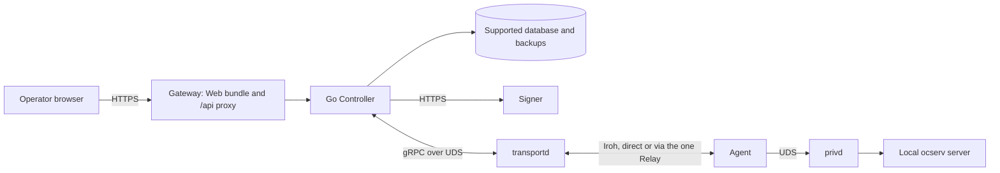
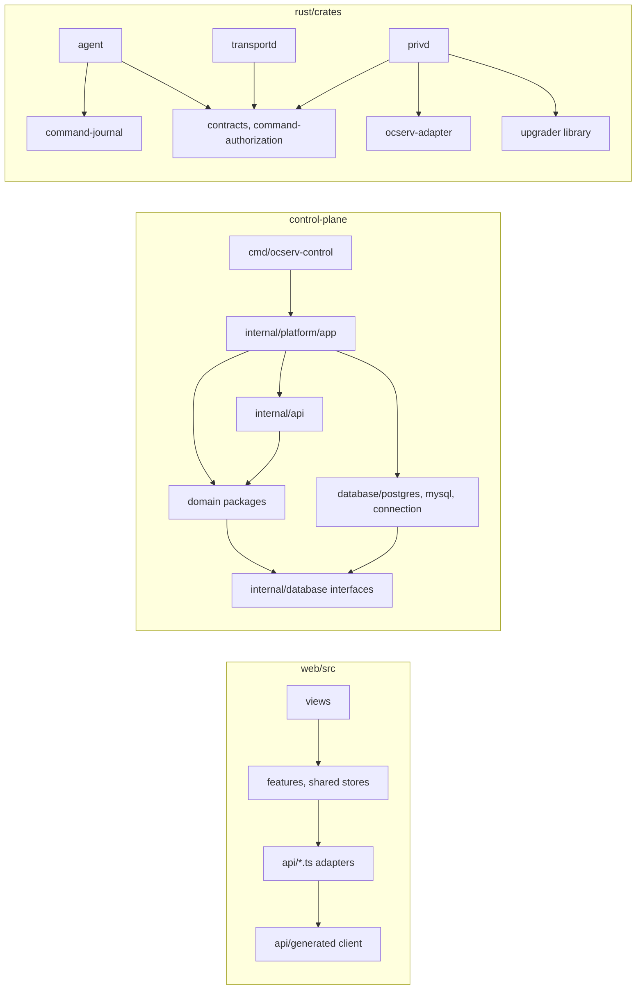

# Architecture

ocservia provides a central control plane for OpenConnect (ocserv) VPN gateways while leaving client tunnel termination and packet forwarding on the gateways themselves. Node administration runs through the Controller, which coordinates cluster visibility, user and group provisioning, configuration distribution, node enrollment, software updates, audit logging, and state recovery.

## Purpose and constraints

Operators use the control plane to verify node trust and reachability, roll out configuration changes without interactive shell access, and reconcile commands whose outcomes become ambiguous. High-risk changes require independent two-principal approval from a second authenticated principal, and disaster recovery preserves node identities alongside the recorded history of state transitions.

A supported production deployment consists of one Controller instance, a relational database, a Signer service for certificate issuance, and a single dedicated Relay serving multiple Agents (a non-empty second Relay URL is rejected). Those services can run on separate hosts, or co-locate on the Controller host in Integrated mode. High-availability topologies such as multi-master Controller clusters, redundant Relays, and automated database failover are outside the [supported scope](reference/support-policy.md#deployment-capability-distinctions); internal lease mechanisms and package modularity do not imply HA support.

Control and data planes remain separate at runtime. Client VPN sessions terminate on the ocserv nodes, and tunnel payloads never pass through the Controller, transportd, or the Relay. If the control plane goes offline, administrative writes, validation, and new command dispatch stop, whereas established client VPN tunnels stay up unless the local node crashes or an invalid ocserv reload disrupts the daemon. Production deployments require pre-provisioned cryptographic keys, working DNS and TLS, a supported database, the Signer service, and an OpenID Connect (OIDC) provider when single sign-on is enabled.

## High-level view



## Main pieces

| Piece | Runs on | What it does |
| --- | --- | --- |
| Gateway | Controller server | Terminates Controller TLS, serves the static Web bundle, and proxies `/api` to the Controller. Integrated mode places an SNI-routing Edge in front of it. |
| Go Controller | Controller server | Serves the HTTP API and runs the outbox worker, scheduler, audit subsystem, node directory, and command dispatch pipeline according to `--role`. |
| transportd | Controller side | Terminates Iroh overlay connections and exposes a local gRPC Unix domain socket to the Go Controller. It holds no database credentials and checks session authorization through a trust socket served by the Controller. |
| Supported database | Controller side | Stores control-plane state, task queues, and recovery journals. PostgreSQL is the default backend. |
| Dedicated Relay | Operator-managed relay host (one) | Forwards encrypted control-plane traffic between the Controller and Agents across NAT or firewall boundaries. Production supports exactly one Relay. |
| Signer | Separate service (bundled in Integrated mode) | Issues and revokes node client certificates and seals secrets to node public keys. See [Production Signer](development/certificates-and-signer.md#production-signer). |
| Managed node service | Each ocserv server | Maintains the Controller connection, reports telemetry and heartbeats, accepts verified commands, and records local execution state. |
| Local privileged helper | Each ocserv server | Executes a fixed set of root-privileged ocserv maintenance routines on behalf of the node agent. |
| Upgrader | Each managed node | Runs package installations, upgrades, and rollbacks outside the main Agent execution loop. |
| ocserv | Each VPN server | The OpenConnect VPN daemon that terminates client tunnels and forwards VPN traffic. |
| External services | Operator environment | Optional or environment-supplied infrastructure for OIDC authentication, telemetry collection, secret storage, and backups. |

Ownership, secrets, interfaces, and failure impact by process:

| Process | Storage and secrets | Interfaces | If it stops |
| --- | --- | --- | --- |
| Gateway | Controller TLS key; no business state | TCP 443 to browsers; HTTP to the Controller | Web UI and HTTP API become unreachable; Controller state and running nodes are unaffected. |
| Go Controller (`--role=all`, single instance in production) | Owns trust, operations, outbox, and audit state in the database; holds the command-signing key, session and audit keys, database application credential, and Signer token | HTTP behind Gateway; client of the transportd socket; serves the trust socket; HTTPS to Signer | Request validation, durable writes, and command dispatch pause; queued operations remain in the outbox. |
| Database | Sole durable store for Controller state | Controller only | Same impact as a Controller outage; restore using [database recovery](operations/incident-recovery.md#database-recovery). |
| transportd | Iroh endpoint key, Relay token, and Controller command verification key; no database credentials | gRPC `TransportService` on a Unix socket; calls the trust socket; Iroh to Agents | Command dispatch and result ingestion pause; in-flight outcomes may become `unknown` until reconciled. |
| Signer | Issuing intermediate key, HTTPS key, and durable certificate ledger | HTTPS `:9443`, on an internal network reachable by the Controller in Integrated mode | Certificate issuance, revocation, and secret sealing fail while unrelated workflows continue. |
| Relay | Relay TLS key and shared access token; no control-plane authority | HTTPS and UDP 7842 | Relay-routed control connections drop, though direct peer paths may stay up. Client VPN traffic is unaffected. |
| Agent | Local SQLite journal and Controller verification key | Outbound Iroh; Unix socket to privd | That node stops receiving commands and sending telemetry; its local journal persists across restarts. |
| privd | Root effect store, attestation key, Controller keyring, and the two sealing private keys | `/run/ocserv-platform/privd.sock`, no TCP listener | Privileged node operations fail or remain indeterminate. |
| upgrader | One-shot `ocservia-upgrader@<operation>.service` started by privd | systemd | Node package upgrades do not advance; see [Agent lifecycle](operations/agent-lifecycle.md). |

At runtime, the Go Controller talks to `transportd` over a local Unix domain socket, and `transportd` exchanges versioned Protocol Buffer messages with remote `Agent` processes over an Iroh overlay (either directly or through the dedicated Relay). On each managed host, the unprivileged `Agent` calls `privd` over a local Unix domain socket for root-level operations. Both the `transportd` control/trust sockets and the `privd` socket enforce peer UID and filesystem ownership checks, while the Relay forwards encrypted packets without holding control-plane signing authority. Local development can substitute `transportd-stub` and `OCSERV_LOCAL_SIMULATOR` (both rejected in production) for the Iroh path. Wire protocol details and process isolation rules are covered in [transport](development/transportd.md) and [Agent/privd](development/agent-privd.md).

## How deployment fits together

Production hosts must match the [production support matrix](operations/production-deployment.md#database-support); development and test fixtures do not expand production support, and backup and restore workflows depend on the chosen database engine as described in [database recovery](operations/incident-recovery.md#database-recovery).

1. Provision the Controller on a supported Linux distribution.
2. Populate `install.env` and place cryptographic secrets in protected directories outside the repository checkout.
3. Deploy the single dedicated Relay that routes control-plane traffic.
4. Install the managed-node package on each target ocserv host.
5. Complete cryptographic node enrollment, complete independent two-principal approval for the pending node in the Controller, and start the node daemons.
6. Manage node configurations, users, access policies, and telemetry from the web console or HTTP API.

## How a node change is applied

```text
Operator request
  -> Controller validates and records the request
  -> high-risk changes wait for independent approval
  -> Controller sends a signed, fixed operation to the node
  -> node runs the matching local ocserv action
  -> result and audit record return to the Controller
```

Command processing separates request acceptance from remote execution across four stages:

1. Ingestion and transactional staging: The HTTP handler routes the request to the owning domain service. Within a single database transaction, the service checks node state and operator permissions, then writes the operation record, payload, transactional outbox entry, and audit event. Committing that transaction records acceptance only; the node has not yet run the command.
2. Outbox dispatch: A background worker claims pending outbox rows in batches and hands them to `transportd` over the active session for that node. Recording dispatch confirms that the message was handed to the transport layer, not that execution succeeded on the host.
3. Node admission and idempotency: Before executing a command, the `Agent` verifies the signature and records the command ID and semantic hash in its local SQLite journal. Duplicate deliveries with the same ID and semantic hash replay the stored result without re-running the action, whereas a different payload under an existing command ID is rejected immediately.
4. Privileged execution and settlement: For mutating operations, the `Agent` marks the journal entry `running` and invokes `privd` over the local Unix socket. `privd` checks the request against its fixed operation rules, executes the ocserv action, and returns a signed execution receipt. The `Agent` persists the terminal status to disk before acknowledging delivery, and the Controller worker ingests the returned event via `localslice.Service.Ingest` (which also processes telemetry) so HTTP queries and Server-Sent Event (SSE) subscribers see the settled state.

The implementation spans the [operation service](../control-plane/internal/operations/service.go), the [outbox worker](../control-plane/internal/operations/worker.go), and the [Agent execution path](../rust/crates/agent/src/main.rs), with idempotency and reconciliation rules defined in the [delivery and recovery contract](development/command-reliability.md). Because Controller database commits, network transport, and host-level daemon effects do not share a distributed transaction, crashes or transport drops can leave an operation in an `unknown` state. Recovery workflows must reconcile `unknown` commands against durable node receipts before any retry, since a healthy daemon status alone cannot prove whether an interrupted reload took effect.

### Code path of a controlled node operation

The table below traces `service:reload`. Other controlled operations share the operation outbox and Agent external-command pipeline, while defining their own HTTP handlers, RBAC checks, and domain transactions at their respective entry points.

| Hop | Entry point | Owner and boundary |
| --- | --- | --- |
| Browser | [`NodeDetailView.vue`](../web/src/views/NodeDetailView.vue) → [`shared/fleet.ts`](../web/src/shared/fleet.ts) `reloadService` → [`api/operations.ts`](../web/src/api/operations.ts) `reloadService` → generated client → [`api/transport.ts`](../web/src/api/transport.ts) | Fleet store tracks operation state; the adapter attaches `Idempotency-Key`, `If-Match`, and approval headers. UI visibility is not authorization. |
| HTTP | [`api/routes.go`](../control-plane/internal/api/routes.go) `POST /api/v1/nodes/{node_id}/service:reload` → [`requireOperationAuth`](../control-plane/internal/api/authorization.go) → [`createControlledCommand`](../control-plane/internal/api/operations.go) | Authenticates the caller, runs `validateBrowserMutation` (mutating requests from non-development principals must carry the trusted browser `Origin`), enforces route RBAC and payload validation, and returns HTTP `202` with the staged operation record. |
| Acceptance | [`operations.Service.CreateSynthetic`](../control-plane/internal/operations/service.go) | A single database transaction verifies the expected node revision, consumes the bound approval, and writes the operation, outbox entry, and audit record. |
| Dispatch | [`operations.Worker.dispatch`](../control-plane/internal/operations/worker.go) → [`Service.Claim`](../control-plane/internal/operations/dispatch.go) → `dispatchFenced` → [`transportclient`](../control-plane/internal/transportclient/) | Claims up to 16 jobs and dispatches them serially. Commands carry an owner fence whenever [`startWorker`](../control-plane/internal/platform/app/worker.go) has initialized an owner-session manager (enabled when `OCSERV_CONTROLLER_ENDPOINT_ID` is set, as required in production Compose; only the local simulator path sends unfenced). `MarkSentWithEnvelope` records transmission only. |
| Transport | [`transportd`](../rust/crates/transportd/src/lib.rs) `send_command` | Unprivileged process that forwards the envelope over the authorized Iroh session. |
| Node | [`agent` `execute_external_command`](../rust/crates/agent/src/main.rs) → [`CommandExecutor::prepare_external`](../rust/crates/agent/src/lib.rs) → [`command-journal`](../rust/crates/command-journal/src/lib.rs) `accept_command` → `PrivdClient` → [`privd`](../rust/crates/privd/src/lib.rs) `dispatch_attested` | The journal transitions through `Accepted` and `Running` before `privd` runs the compiled action and signs a receipt. A command reaches a terminal state only with a valid `privd` receipt; missing receipts, unclassified `privd` errors, transport drops, or replays of non-terminal entries settle as `Unknown` without re-executing. |
| Result | [`localslice.Worker`](../control-plane/internal/localslice/) → [`Service.Ingest`](../control-plane/internal/localslice/ingress.go) | Verifies each incoming transport event and commits its result or telemetry in a single transaction. Upon owner reconnect, [`RecoverAmbiguousDispatched`](../control-plane/internal/operations/recovery.go) re-signs ambiguous commands as `RECONCILE_ONLY`; see [command reliability](development/command-reliability.md). |

Privileged execution on a managed node is limited to compiled routines inside `privd`, which rejects arbitrary binaries, shell command strings, dynamic systemd unit names, and unconstrained filesystem paths.

Node enrollment uses a separate handshake protocol: a single-use token binds the node's persistent `EndpointID` to a pending inventory record, and the node requires independent two-principal approval before the `Agent` can establish an authenticated control session. Installing the package or starting local services does not grant control-plane access prior to approval; see [enrollment](how-to/enroll-node.md) and [`enrollment/service.go`](../control-plane/internal/enrollment/service.go).

## State and recovery boundaries

| State | Authority and persistence | Recovery consequence |
| --- | --- | --- |
| Node trust, desired state, operations and audit history | Controller database, accessed through domain Store contracts | When a commit outcome is uncertain, preserve the original operation ID and payload; client timeouts must not trigger uncoordinated duplicate submissions. |
| Command acceptance and results | Agent-owned SQLite journal | The local journal must persist across service restarts and package upgrades. Deleting it breaks replay detection and outcome reconciliation. |
| Privileged effects | Node-side effect records and signed privd receipts | Reconciliation requires cryptographic receipts bound to the specific command ID; observing the target configuration hash on disk does not prove a specific historical command succeeded. |
| Certificate issuance and revocation | Signer's durable ledger and issuing identity | Restoring the Controller database and Signer ledger must be coordinated before certificate operations resume. Recorded revocations do not terminate active VPN tunnels or publish external CRLs automatically. |
| Health and session observations | Agent reports ingested into Controller read models | Cached telemetry reflects the last ingested report and does not prove that the node or ocserv daemon is currently reachable. |

An outage of the Controller or its database halts request validation and durable writes, leaving queued operations in the outbox until they either run after recovery or expire. If `Agent` or `privd` crashes during execution, the operation remains indeterminate even when network delivery succeeded. If the Relay becomes unreachable, control-plane sessions through that Relay drop until the Relay returns and the Controller reconciles pending node state.

Recovery procedures preserve command logs, local SQLite journals, endpoint identities, and monotonic sequence numbers. Restoring from a cold backup requires running the documented verification workflow and neither provides automatic failover nor relaxes schema identity checks; see [incident recovery](operations/incident-recovery.md), [Signer recovery](development/integrated-deployment-contract.md#compatibility-and-recovery), and [resilience coverage](development/resilience.md).

## Design tradeoffs and capacity

The Controller is structured as a modular monolith in which domain services share relational database transactions. Keeping domain state changes, outbox staging, and audit records in a single local transaction avoids two-phase commit or external message brokers while the deployment model remains single-instance. In [`platform/app/app.go`](../control-plane/internal/platform/app/app.go) (`Run` and `runRoles`), a single binary can start the API, worker, and scheduler roles individually or together (`--role=api|worker|scheduler|all`), with production running a single `all` instance. The scheduler acquires a database lease and ticks every 30 seconds; on `SIGINT`/`SIGTERM` or the first role error, the process stops HTTP admission and SSE streams, closes the trust socket, and waits up to `OCSERV_SHUTDOWN_TIMEOUT` for in-flight tasks.

Using a database-backed transactional outbox means task leasing, historical audit queries, and live API writes share the same database connection pool and row locks. Polling loops backstop in-memory wakeups so queued commands still drain after transient notification drops, and local `Agent` journals prevent duplicate side effects on redelivery, while ambiguous executions pause for explicit reconciliation.

Separating `transportd`, `Agent`, `privd`, and `upgrader` into distinct OS processes adds local IPC hops and systemd coordination, in exchange for keeping network-facing parsing and unprivileged state management separate from root execution and package lifecycle scripts.

End-to-end command throughput is bounded by database lock contention, outbox worker polling intervals, and serial execution of mutating commands on each node. Both the Controller [outbox worker](../control-plane/internal/operations/worker.go) and the node `Agent` process claimed mutating commands sequentially, while the global [command limit](../control-plane/internal/commandlimit/limit.go) acts as backpressure admission control across nodes and workspaces.

Before tuning concurrency settings or splitting services, measure queue depth, maximum uncommitted task age, database lock wait times, and telemetry age under representative load. Low [queue metrics](development/command-reliability.md#controller-delivery) indicate fast dispatch from the Controller outbox, though downstream node execution must still be verified independently. Any proposal to split a subsystem into a standalone service should be driven by measured scaling, release-isolation, or fault-isolation needs and validated against fault-recovery scenarios.

## Safety model

- Production deployments pin immutable release tags or container image digests.
- Managed-node packages are verified against an expected SHA-256 digest (supplied by the operator or a signed Controller upgrade command) before installation; a plain checksum guards against file corruption and does not grant execution authority.
- Private keys, TLS certificates, relay access tokens, and database or admin credentials are provisioned out of band in protected host directories.
- High-risk mutations require independent two-principal approval bound to the exact request payload, with self-approval rejected. The system enforces separation across two distinct authenticated principals, credentials, and sessions, while human two-person custody of those credentials remains outside what the software can automatically verify ([approval principal boundary](reference/stable-contracts.md#approval-principal-boundary)).
- Audit events commit in the same database transaction as the state changes they record.
- Production rollouts require tested backup restoration and rollback procedures.

## Development architecture

ocservia lives in a single repository organized around explicit module and process boundaries: the Go Controller is a domain-packaged modular monolith, the Rust crates isolate overlay transport (`transportd`), node state (`agent`), privileged execution (`privd`), and package lifecycle (`upgrader`), and the Vue frontend separates route views, workflow stores, handwritten API adapters, and generated schema bindings. New features should fit into the owning package or crate without introducing extra wrapper layers.

### Ownership and task navigation

Consult the row that matches the area you are changing; each linked document holds the detailed behavioral and compatibility rules for that boundary.

| Boundary / task | Responsibility and dependency direction | Read next |
| --- | --- | --- |
| Startup and assembly | `cmd` and `platform/app` wire dependencies, start configured roles, and coordinate graceful shutdown. Domain packages must not import assembly packages. | [`platform/app`](../control-plane/internal/platform/app/) |
| HTTP compatibility | HTTP handlers decode requests, bind caller authentication and authorization context, and encode responses, leaving business invariants and transactions to domain services. | [HTTP baseline](development/http-baseline.md) |
| Controller services | Packages depend on narrow consumer interfaces defined where they are used, without speculative abstraction layers. | [Consumer service boundaries](development/domain-service-boundaries.md) |
| Data and transactions | Domain store interfaces decouple business logic from SQL drivers. The initiating domain service opens and commits `database.Tx` so multiple stores can participate in one atomic transaction without importing driver packages. | [`database` boundary](../control-plane/internal/database/database.go), [existing boundary check](../control-plane/internal/database/boundary_test.go), [operations and outbox](development/command-reliability.md#controller-delivery) |
| Runtime and privileges | `transportd` runs unprivileged on the Controller side to handle Iroh networking; `Agent`, `privd`, and `upgrader` run under separate OS accounts and systemd units on managed nodes. | [Transport](development/transportd.md), [Agent/privd](development/agent-privd.md), [Agent lifecycle](operations/agent-lifecycle.md) |
| Web API and Workspace | Views compose feature workflows and shared stores, which call handwritten `api/*.ts` adapters over the generated client. Session and workspace state stay in their canonical stores. | [Web API boundaries](development/web.md#api-boundaries), [node-detail features](development/web.md#node-detail-workflows) |
| Protocols and generated code | Protobuf (`proto/`) and OpenAPI (`openapi/openapi.yaml`) own wire schemas. Signatures and semantic hashes use versioned canonical transcripts; raw Protobuf wire bytes are never signed directly, and generated code stays isolated from handwritten domain logic. | [Schema sources and generation](reference/stable-contracts.md#schema-sources-and-generation), [Agent/privd protocol](development/agent-privd.md), [command authorization](development/command-authorization-v1.md), [semantic hash v2](development/command-semantic-hash-v2.md) |
| Deployment | Production installs use pinned release artifacts, out-of-band secrets, and the repository's lifecycle scripts. | [Production deployment](operations/production-deployment.md), [Controller upgrade](how-to/controller-lifecycle.md#upgrade), [Agent lifecycle](operations/agent-lifecycle.md) |
| Validation | Changes are verified with the smallest test, lint, or integration suite that covers the affected contract. | [Validate a change](development/testing.md) |

### Source dependency view

Arrows point from the importing package to the imported package. This graph shows the primary compile-time dependency direction (some views also import API adapters directly) and is distinct from the runtime process topology in [High-level view](#high-level-view); compile-time package boundaries do not replace runtime privilege checks.



The Signer service lives in its own Go module (`signer/`, wired via `go.work`) and communicates with the Controller strictly over HTTPS. On the Rust side, `privd` links the `upgrader` library to trigger the `ocservia-upgrader@` systemd unit, and `agent` pulls in `transportd` only as a `[dev-dependencies]` crate for tests. Exact crate dependencies are defined in `rust/Cargo.toml` and each crate's manifest.

Runtime process graphs and source import graphs serve different purposes: how processes are supervised or connected over sockets is independent of how source packages import one another. Add a new diagram only when a change introduces a new process, trust boundary, or isolation model.

### Intentional exceptions

- A narrow consumer interface with a single production implementation is acceptable when it keeps a domain package decoupled from another subsystem or driver.
- Multi-entity updates may share a single `database.Tx` across domain stores whenever atomic commit semantics require it.
- HTTP request validation, in-transaction state re-checks, and node-side signature/fence verification guard different trust boundaries and are intentionally kept separate.
- Cookie management in `auth`, engine-specific SQL in database adapters, and legacy route aliases may deviate from uniform layering where protocol or compatibility rules require it.
- File length, shared DTOs, or package counts are review signals to inspect coupling, not standalone reasons to split packages without a concrete boundary violation.

### Evolution and decisions

Changes that stay within existing domain and process boundaries follow normal code review and validation. Proposals that alter transaction boundaries, public HTTP/Protobuf schemas, privilege separation, or process topology should state the motivating requirement, operational constraints, rejected alternatives, migration impact, and rollback plan.

Splitting a package into a separate service or adding caching and queueing infrastructure requires concrete evidence of a scaling, release, or fault-isolation bottleneck. Exploratory analyses do not change production support commitments. When significant architectural trade-offs are made, record their context, evaluated options, consequences, and revisit conditions alongside the owning subsystem documentation.

Decisions governing single-host Integrated networking, the Signer service, and command delivery are recorded in the [Integrated deployment contract](development/integrated-deployment-contract.md), while step-by-step operator commands live in the [Integrated deployment procedure](../deploy/production/integrated/README.md). Neither document widens the [production support policy](reference/support-policy.md).

The structure of these design documents draws on Lenciel's [How to write system design docs](https://lenciel.com/2021/01/how-to-write-system-design-docs/), [Awesome Architecture](https://github.com/study8677/awesome-architecture) (chapters 02 and 08), the [C4 diagram conventions](https://c4model.com/diagrams), and [Nygard's ADR format](https://www.cognitect.com/blog/2011/11/15/documenting-architecture-decisions), adapted to the concrete boundaries in this repository.

## Where to read more

- [Deploy the Controller](getting-started/production.md)
- [Install a managed node](getting-started/managed-node.md)
- [Enroll a node](how-to/enroll-node.md)
- [Dedicated Relay](how-to/dedicated-relay.md)
- [Production deployment reference](operations/production-deployment.md)
- [Agent package lifecycle](operations/agent-lifecycle.md)
- [Technical reference](README.md#technical-reference)
